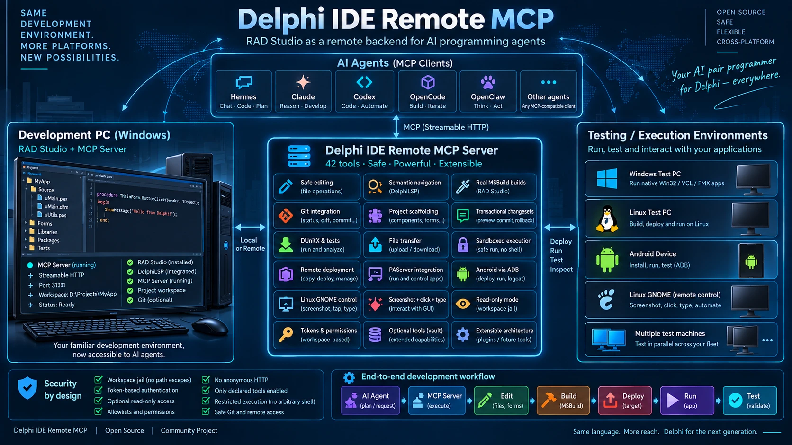

# Delphi IDE Remote MCP Server

[](https://github.com/soporte-defontsoft/delphi-ide-remote-mcp/releases/latest)
[](LICENSE)



**An MCP server that remote-controls a full RAD Studio (Delphi IDE) installation — language server, build system, deploy chain — so you can develop in Delphi from any platform. And the agent gets eyes and hands on a real screen too — an Android device, a Linux GNOME desktop or a Windows desktop behind a PAServer (the server's own included): it sees what is there and drives it.**

📦 **[Download the ready-made Windows binary →](https://github.com/soporte-defontsoft/delphi-ide-remote-mcp/releases/latest)** (no Delphi needed to *run* the server binary; the machine it runs on needs its own licensed RAD Studio). 🚀 **[Quickstart: five steps from zero to the first call →](QUICKSTART.md)** — unzip on the Delphi PC, a five-line `settings.ini`, `-gui`, connect a client, `delphi_workspace`.

The Windows machine holds RAD Studio and the projects. You work from wherever you actually want to be: a Linux laptop, a Mac, a cloud agent, a CI runner. Understand the code, edit it safely, scaffold, build, run, package, fetch the binaries, commit — and then deploy to a real target and **watch your app run there, pressing its buttons yourself** — the whole cycle over MCP, with Delphi installed on **neither** the client nor the agent.

It is not a language-server bridge. Semantic understanding is one capability of many, and it is the one that is genuinely hard, so it runs on Embarcadero's official `DelphiLSP.exe` — the same engine behind Code Insight in the RAD Studio IDE. But the language server backs **8 of the 42 tools**; the other 34 are the working day: the safe editing engine, MSBuild, git, the file tools, the project scaffolder, the deploy chain (PAServer, adb), the RAD Studio help, the knowledge vault. See [What each tool actually runs on](#what-each-tool-actually-runs-on) for the exact split.

Runs as a **Windows Service**, a terminal process or a tray app — one executable, three modes — keeping language-server processes warm across agent sessions and serving multiple AI clients (Claude Code, Claude Desktop, or any MCP client) over Streamable HTTP, with a classic stdio mode as well.

> **Status: latest 1.19.1 (published today, validated by its batteries); stable 1.16.0 (a week in production and Hermes's nightly validation behind it).** Covered by 201 end-to-end batteries — 5,658 checks — against DelphiLSP 37.0 (RAD Studio 13), and by a full day of real-world field testing by an independent agent using it as a client. A minor version adds tools or capabilities, a patch fixes, and a documented contract that changes is announced in the CHANGELOG first. See [docs/ARCHITECTURE.md](docs/ARCHITECTURE.md) and [docs/DELPHILSP-NOTES.md](docs/DELPHILSP-NOTES.md) for the measured research this project is built on, [CHANGELOG.md](CHANGELOG.md) for versions, and [docs/ROADMAP.md](docs/ROADMAP.md) for what is delivered, open, parked or declined.

## Why

AI agents working on Delphi codebases are usually limited to text search (grep). This server gives them the **full remote development workflow over Delphi and its projects** — understand, edit safely, verify, build, deploy, run and drive the result — through the real compiler front-end and inside an operator-declared jail. In short: **RAD Studio turned into a remote backend for programming agents.**

**The core idea: centralize Delphi, work from anywhere.** One Windows PC or VM holds the RAD Studio installation and the projects; this server runs there. Everything else — your laptop, a Linux box, a CI runner, an agent in the cloud — connects over MCP HTTP and gets the full development cycle (locate a project, read, edit, scaffold, build, run, download the binaries, commit) **without installing Delphi, or anything at all, on the client side**.

**The showpiece: your app on a real Linux desktop, seen and driven from the agent.** Deploy to a GNOME machine through PAServer, launch it with `remote-run` (the program is not killed when the call returns — a window is meant to stay up), and then `delphi_desktop` brings the **whole desktop back as a PNG**, presses the exact pixel you measured, types into your app, walks its windows. Beyond PAServer itself there are no prerequisites and nothing to install by hand on the target: it executes what this server sends, and the tiny helper node — **shipped inside this release** — deploys and updates itself on first use. It is the same eyes-and-hands idea `delphi_adb` gives you on Android — pointed at a Linux desktop. Today it speaks GNOME (Zorin and Fedora, measured live). And the node itself is the proof of the whole premise: **it was developed entirely through this server** — an AI agent on the other end of the MCP wrote it, compiled it, deployed it and debugged it against the live targets, without ever sitting at the Windows machine. This repo dogfoods its own tools.

**And the same eyes and hands on a Windows desktop - including the server's own.** Since 1.0.16 there is ONE desktop tool, `delphi_desktop`, and the machine is a parameter: the PAServer profile. Point it at a Linux, at a Windows with PAServer, or at this very server when a PAServer runs in its user session (`windows-local`, 127.0.0.1): same node, same gestures, same permissions (`AllowRemoteRun`, `RemoteHosts`, `RemoteRunProjects`). Every remote execution - Linux or Windows - goes through ONE mechanism: a job file (the binary, the output file, then one argument per line) and a native launcher (`node\McpRunJob`, `node\McpRunJob.exe`) that PAServer starts; there is no shell in the path, so an agent's arguments reach the program as argv, untouched. The old name, `delphi_adb_linux`, no longer exists.

## Use cases

Two credential levels — a full read-write token, and a read-only one — let very different agents share the same live codebase safely. The read-only level can read, search, navigate symbols, get diagnostics, follow definitions into RTL/VCL and installed components, download files and run query-only git; it can touch **nothing** on the server. That opens up a range of setups:

- **Move your daily work to another OS.** The Windows box with RAD Studio becomes a remote build server; you drive it from a Linux laptop, a Mac, or a cloud agent. Full read-write token, VPN/LAN only. Edit, scaffold, build, run, fetch the binaries, commit — Delphi never leaves the server.
- **Deploy-and-verify on a real Linux desktop, hands on the app.** Build on Windows, deploy over PAServer, launch with `remote-run`, then SEE the GNOME desktop and drive the app — tap its buttons, type into its fields, close its windows — all from the agent, with nothing installed on the Linux box. The closing mile of the cycle: not "it compiled", but "I watched it run and used it". Since 1.0.16 the launch also works when PAServer runs as a **service** on the target: the launcher completes the graphical session's `DISPLAY` / `WAYLAND_DISPLAY` / `XAUTHORITY` when PAServer did not inherit them, and the answer says so (`graphicalEnv`).
- **A documentation / wiki / RAG agent that cross-checks the real source.** Give it the read-only token. It maintains the wiki or answers questions from a RAG index, and whenever it needs to be sure, it confirms the claim against the actual code — "does `TOrderService.Post` really validate the tax id?" — instead of trusting a possibly-stale document. Grounded answers, zero write risk.
- **A code-review / audit agent on every branch.** Read-only. It reads diffs, walks symbols with compiler-grade accuracy, follows calls cross-unit and into VCL, runs on-demand diagnostics (real E/W/H codes, no build) — and cannot alter the tree it is reviewing.
- **An onboarding / Q&A assistant for the team.** Read-only, pointed at the whole `Roots`. New developers ask "where is X handled, what calls Y, what's the type of Z" and get answers from the live sources, not a wiki that drifts.
- **The programming agent + the reviewing agent, side by side.** One holds the read-write token and does the work; another holds the read-only token and independently checks it — two agents, one codebase, only one able to write.
- **A CI / release runner.** Read-write on a locked-down VM: pull, build Release, package the deploy, upload/fetch artifacts, tag — all over MCP, no interactive IDE.

An agent can also be pointed at the **library read zone** (RTL/VCL sources and installed third-party components) to reason about framework or component internals, still without any write capability.

**Several agents at once is a supported case, and it is measured.** The HTTP host serves every request on its own thread, and each one carries its own workspace and access level, so two agents with different tokens never see each other's jail. Where they DO meet is the machine underneath: the writes of one file, a project's `.dpr`, msbuild, the desktop, a target machine. Those are serialized — one build at a time (the answer says how long it queued), one edit at a time per server, one gesture at a time per desktop or per PAServer profile — and the artifacts that used to collide (screenshots, reports, packages, backups) now carry a name of their own. `tests/test_concurrencia.py` fires bursts of simultaneous agents at all of it and checks the disk afterwards. Two caveats stay honest: **the locks are per process**, so running a second server against the same tree (a tray plus a stdio client, for instance) puts them outside each other's reach; and serialized is not coordinated — two agents editing the same file take turns, they do not agree.

## What each tool actually runs on

The language server is the hardest part to get right, but it is not most of the server. Of the 37 core tools, **exactly 8 are backed by DelphiLSP**; the other 29 never touch it (plus 5 optional `vault_*` tools, registered only when you configure a vault). This matters in practice: the LSP-backed tools are the only ones that need a resolvable project configuration — the rest work on any folder inside the roots.

**Backed by DelphiLSP (8):** `delphi_symbols`, `delphi_definition`, `delphi_hover`, `delphi_completion`, `delphi_signature`, `delphi_diagnostics`, `delphi_references` (hybrid — LSP-validated, see the table) and `delphi_rename_symbol` (semantic rename built on definition + references; `mode=apply` writes it through the changeset engine).

**NOT DelphiLSP (the other 29):** `delphi_read`, `delphi_edit`, `delphi_textedit`, `delphi_create`, `delphi_build`, `delphi_list`, `delphi_search`, `delphi_projects`, `delphi_workspace`, `delphi_move`, `delphi_delete`, `delphi_fetch`, `delphi_upload`, `delphi_package`, `delphi_git`, `delphi_installs`, `delphi_config`, `delphi_paserver`, `delphi_adb`, `delphi_desktop`, `delphi_components`, `delphi_styles`, `delphi_messages`, `delphi_changeset`, `delphi_designer`, `delphi_test`, `delphi_report`, `delphi_help`, `delphi_docs` — plus the 5 `vault_*` tools. These run on MSBuild, git, the filesystem, the registry, adb, the safe-editing engine, the installed RAD Studio help and your vault.

The table below says which engine each one uses and why it matters:

| Engine | Tools | What that means for you |
|---|---|---|
| **DelphiLSP** (official, compiler-grade) | `delphi_symbols`, `delphi_definition`, `delphi_hover`, `delphi_completion`, `delphi_signature`, `delphi_diagnostics` | Real semantic answers, not grep: resolves inheritance, `with`, overloads, and follows into RTL/VCL. Needs a `.delphilsp.json` (used when fresh, fabricated from the `.dproj` when not). |
| **DelphiLSP + disk scan** (hybrid) | `delphi_references` | The LSP has no `references`, so candidates are scanned from disk and then each one is *validated* by asking the LSP where it resolves to. Verified against the live compiler, never an index. A name written in a comment or inside a string literal is **not** a reference: it goes to `mentions`, listed but harmless, instead of counting as `unverified` and blocking a rename. |
| **Own safe-editing engine** | `delphi_read`, `delphi_edit`, `delphi_textedit`, `delphi_create` | Anchored edits with encoding preserved (ANSI vs UTF-8), atomic writes, automatic backups, designer-file awareness. No LSP involved. |
| **MSBuild** (`rsvars.bat`, located via the registry) | `delphi_build` | The real compiler and linker. The LSP cannot build — it has no such operation. A failed build with F2613 names each missing unit and where its `.pas` lives in the library zone (`missingUnits`), with the `add-searchpath` to run |
| **MSBuild, then a sandboxed runner** | `delphi_test` | **Does it WORK, not just compile**: `discover` finds the test projects (DUnitX, or console runners named *Test*), `run` builds and runs one in a Windows container of its own, on a copy of its output folder (nothing else, no network), and answers structured — total/passed/failed, the failing lines, exitCode, duration. Own opt-in (`AllowTests`) |
| **The filesystem, jailed** | `delphi_list`, `delphi_search`, `delphi_projects`, `delphi_workspace`, `delphi_move`, `delphi_delete`, `delphi_fetch`, `delphi_upload`, `delphi_package` | Navigation, transfer and housekeeping inside the workspace roots. |
| **`git.exe`**, arguments composed by the server | `delphi_git` | Query commands at every level; writes only read-write. Never a shell, and never on a repository that lives outside the roots: its root folder and its `.git` go through the gate too, and git runs pinned to them. A remote that is a folder goes through the same gate, and so does every path in `paths`: a share or a device path is refused before git runs (until 1.18.1 git opened the network with the service's account), a virtual unit becomes the real path. Since 1.19.0 there are no free arguments: each command takes its own fields and the server composes the line, choosing from what git reports (a revision it finds, a name it accepts, a remote of the repository). |
| **Registry / IDE configuration** | `delphi_installs`, `delphi_config`, `delphi_paserver` | Which RAD Studio versions exist, project platforms and output paths, remote-target profiles and SDKs. |
| **The IDE's own `adb`** (found via the SDK Manager's `.sdk` files) | `delphi_adb` | The Android devices hanging off the server — discover, attach, install, run, screenshot, tap, logcat — with the exact adb the IDE itself uses. |
| **The desktop of a PAServer target** - Linux, Windows, or this server itself (a small Delphi node this server deploys there) | `delphi_desktop` | Bring the whole desktop here as a PNG, measure the pixel, press it, type into it. Nothing installed on the target beyond the node itself; the machine is the `profile` parameter. |
| **Its own `.style` parser and `DelphiStyleConvert.exe`** | `delphi_styles` | **FMX styles by StyleName**: `view`/`get` a text `.style`, `set` one property of a style or of a part, `clone` a variant, `delete` one, `lint` (duplicated StyleNames, `StyleLookup` values of the project's `.fmx`/`.pas` that no style defines, design tokens missing in a theme, `.rc` entries without file) and `build` (text `.style` → `.bin.style` the app embeds, `.rc` → `.res`). Ships `DelphiStyleConvert.exe` next to the server |
| **The IDE's registry** (Known Packages — what the palette loads) | `delphi_components` | The design packages installed in the server's RAD Studio, whatever the install channel — what the agent has available to program with. List only; installing stays a human decision. |
| **The RAD Studio help** (the `.chm` files the IDE registers - the ones F1 opens - read in place with Windows' own help storage) | `delphi_docs` | The documentation of the Delphi installed here, as a wiki the agent pages through: `search` gives a short list (id + title, the best first; `framework=vcl\|fmx` for a class both have), `read` gives one page as text in chunks. It asks for no switch, in any workspace: it opens only the help files the IDE itself registers. For an exact signature the installed sources win (`delphi_hover`, `delphi_definition`). |
| **Your Markdown vault** | `vault_read`, `vault_search`, `vault_append`, `vault_create`, `vault_patch` | Persistent memory, isolated from the code tools (see below). |
| **A folder the server owns** | `delphi_messages` | The operator's **mailbox** (the way back of `delphi_report`): `.md` files left in `messages\<workspace>\<agent>\` are delivered once by `read`, which deletes them; while one waits every tool answer ends with a `PENDING MESSAGES` line. The workspace folder is `Workspace.` and its name in lower case (`messages\Workspace.claude\hermes\`), plus `-` and eight characters of its MD5 when the name has spaces, accents or signs (`[Workspace.Hermes VM]` is `Workspace.hermes-vm-xxxxxxxx`), taken from the token: one workspace never sees another's mail |
| **The same folder** (`reports\`) | `delphi_report` | The feedback channel back to us; the one write a read-only client may perform. Reports land in `reports\<workspace>\<agent>\`, and `command=list` / `read` show them to that workspace only, moving nothing |

## Persistent memory for your agents (optional)

Every session, your agent starts from zero. It can read your code, but it does
not know *why* that unit is built the way it is, which conventions your team
follows, what was already tried and rejected, or where a project stands today.
So you explain it again. And the next session, again.

Give a workspace a `VaultPath=` pointing at a folder of Markdown notes — an Obsidian vault, or just
a folder — and that stops. The agent gets **`vault_read` and `vault_search`**:
a memory it consults before touching the code. Optionally (`VaultReadOnly=0`) it also
gets **`vault_append`, `vault_create` and `vault_patch`**, so it records what it
learned for the next session — and for the next agent.

This matters most in the remote setup this server exists for: an agent on Linux
has no filesystem access to the Windows machine at all, so without this its
memory is whatever fits in one conversation.

It works by itself. On connect the agent is told there is a vault and to start
with `vault_read` (no path); that one call returns the vault's **rules** and its
**index**, and from the index descriptions it loads only the notes that apply —
lazy loading, so a memory that grows for years still fits in a context window.

Two design choices worth knowing before you enable it:

- **The doctrine lives in the vault, not in this server.** Your rules are a file
  *inside* your vault (`AGENTS-VAULT.md`), so two people can point this at two
  different vaults and each gets their own conventions, in their own language.
  Nothing about your way of working is hardcoded here.
- **What can be enforced by code is enforced by the server**, not left to the
  model to remember: the original of any note is backed up before it changes,
  the rules and index files are never writable, and there is no rewrite, delete
  or move — only append, create and anchored replace. A confused model cannot
  destroy accumulated knowledge.

Off unless you configure it. Point `DELPHI_MCP_VAULT_PATH` (the local launch mode) at an empty folder and the server creates
a working starter vault for you; for a `[Workspace.<name>] VaultPath=` copy the ready-made one in
[`examples/vault/`](examples/vault/). **Full explanation: [docs/VAULT.md](docs/VAULT.md).**

## The four questions every Delphi developer asks first

Not "what tools are there" — that is the table below. These are the objections a Delphi person
raises before letting any agent near their tree, and the honest state of each. Every claim here
was re-checked against the running server by an agent whose job was to disprove it; where
something is *not* solved, or only half solved, it says so.

**"An AI will corrupt my `.dfm`."** The likeliest failure. Three defences, in order: a **binary**
`.dfm`/`.fmx` is never written as text — every tool that writes refuses it, in both shapes, the raw
`TPF0` stream and the resource-wrapped form it actually takes on disk; `delphi_read` and the
`delphi_designer` readers show it as text on the fly, with the IDE's own conversion, and say so;
and `delphi_designer to-text` / `to-binary` convert it on disk, backup first. A **text** one is validated by
`delphi_designer lint` against the framework tables of the active Delphi (what the class actually
publishes, not a guessed list): properties that do not exist, properties that exist but are not
published, values their type does not take (bad enum values and set members, a `Color = 'hola'`: the checks of `set`), each with its line, *before* MSBuild ever sees
the file. And `delphi_designer check-binding` answers the question the compiler never asks — does
the `.dfm` agree with the class? A component with no published field, an `OnClick` naming a method
that is not there **or one declared outside `published`** (the form loader only sees published
methods), a duplicate component name, an event left without a value: every one of those **builds
perfectly and throws when the form is created**, on a machine where nobody is watching. It follows
inheritance as far as the unit goes and says so when the ancestor lives elsewhere, rather than
reporting inherited members as missing. And the commonest edits do not go through hand-written text
at all: `delphi_designer insert`, `set` and `delete` compose the lines the IDE would write, check
them against the same tables first, and write the form (and its unit, when the edit touches it) all
or nothing.
Those tables are **read from each installed Delphi's own source** — the IDE's Library Search Path
and Browsing Path, Win32 and Win64, so the components you installed from source are in too —
never compiled into the server for one version. Every class, enumeration and set is known by its
**unit** (the VCL's `TFont` and TeeChart's are two classes; FireDAC's and IBX's `TIBProtocol` two
enumerations), and what a class streams **by code** without publishing it is read as well — its
`DefineProperties`: `Left`/`Top` of a non-visual component, `TField.Lookup`, the old FMX names a
`TLabel` still loads (`Font.Size`). When two units declare a component with the same name, the one
a source registers on the palette names it in a form; when nothing decides, the form line is not
judged and the lint says so. At startup the server generates, in the background, the table of every
Delphi that has none (≈14 s for the 3,938 units of a RAD Studio 13 with JVCL, QuickReport and ICS)
and keeps it in `%LOCALAPPDATA%\DelphiLspMcp\designer` with a fingerprint of that source: install or
touch a component and the first designer call after it regenerates the table in the background
while the previous one answers. No call ever generates inside an edit: an edit of a form made
before the first table exists says it did not check (`DSGN-052`). A Delphi with no source gets no
table and the designer says so (`DSGN-050`) instead of checking a form against another version. The
class a property *really* holds is chosen by code (`TLabel.TextSettings` holds a
`TLabelTextSettings`), so going down such a property the lint accepts what a descendant of the
declared type publishes. Measured on the 669 text forms of the RAD Studio Samples: no warning,
except six lines whose class a package registers without source (`tests/test_designer_corpus.py`).
The tables name the classes, published properties and enum members of every component in those
paths, for every workspace whatever its `LibraryZone` - names, not source.
*Not solved:* `preview` draws the form as the designer shows it and `layout` resolves the geometry
and catches overlaps, zero-size controls and anything falling outside its container, but neither
can tell you the result is *pretty*. Members inside an inactive `{$IFDEF}` are counted as if they
compiled. Neither `lint`
nor `check-binding` checks that a component's class matches its field's type, that a handler's
signature fits the event, or that `Action = X` points at something real.

**"MSBuild output will flood the context."** `delphi_build` never returns raw log. It returns one
already-extracted line per problem in `errors[]` and `warnings[]` — file, line, code and message,
though **not** a separate column field — plus an `outputTail` capped at ~25 lines and `firstError`,
because one `E2009` can spawn seven `E2250` that look like unrelated failures, and an agent that
chases the last error chases noise. `errors[]` itself is **not** capped: a build with forty errors
returns forty, deliberately, since truncating the list is how "it only had one problem" gets
believed. Same shape for `delphi_test`: total/passed/failed and the failing lines, not a console
dump — and when the runner prints a format this server cannot count, a non-zero exit code is
reported as a failure, never as "it ended fine".

**"Files get locked — by the IDE, by a hung exe — and everything dies with Access Denied."**
Real, and it surfaces cleanly: a locked output is one `F2039 Could not create output file`,
already parsed into `errors[]`, with a hint naming the likely cause (the app still running, the
IDE holding the target, an antivirus). **This server will not kill processes on the host** — that
is deliberate, not missing: a human may be sitting at that IDE. Test runs are the exception and
kill only their own child, on their own timeout. **What the server itself holds, the server lets
go of:** the DelphiLSP engine makes the folder of the project's main source its current
directory when it loads the project's settings, and Windows will not rename or delete the
current directory of a live process, so before a folder is deleted, moved, purged or removed as
a git worktree - or a `delphi_git` switch, merge, stash or pull rewrites the tree - the engines
of the projects inside it are stopped (what rewrites nothing stops nobody: `stash list`, `switch`
with `create`; and `stash` with `paths` stops the ones of those folders only). They start
again on the next request; a request of
another agent that was in flight on one of them is told at once (`LSP-033`: repeat it), and no
engine is started under a folder while it is being taken away (`LSP-032`). Until then a single
`delphi_hover` was enough for `delphi_delete` of the project's folder to answer `FILE-036`.
`pull` does its network half first, as a `fetch`, with nobody stopped; the pull that follows
finds its commits there and is the one that stops the engines.
*Not solved:* an agent cannot confirm **which**
of those causes it is — there is no process or handle listing here, by the same decision.

**"What about my third-party packages — Boss, GetIt, submodules?"** Search paths are first-class:
`delphi_config command=add-searchpath` edits them **per platform** (Delphi keeps unit search paths
per platform, not per Debug/Release configuration), `delphi_config command=view` reports what a
project resolves against, `delphi_components` lists what is installed in the IDE, and the library
read zone lets an agent read RTL/VCL and component sources without any write rights. A failed
build reports `missingUnits` with the folders that do hold each unit — *though it looks through
the installed component sources, not through your own workspace.* A Linux link that fails with `cannot find -lX` because the pulled sysroot lacks the `-dev` name (`libX.so`) is completed in the SDK from the versioned library it does have, retried once and reported in `sdkLinkNote` - nothing to install on the target.
*Deliberately absent:* running `boss install` / package managers. That is arbitrary code
downloaded from the internet and executed on the build host — exactly what the git
remote allowlist and the host allowlist exist to gate. If you want it, it needs its own opt-in
switch and its own allowlist; it will not arrive by accident.

> **Start here, whoever you are.** `delphi_help` is the map: `command=tasks` gives a
> task→tool table, `command=tool name=<x>` explains one tool and every parameter it takes, and
> `command=conventions` is the house rules — how to read the `[AREA-NNN OUTCOME]` tag an answer
> starts with, how the
> recoverable trash works, how agents identify themselves and share a mailbox. An agent that
> calls it first stops guessing.

## The tools

| Tool | What it does |
|---|---|
| [`delphi_help`](docs/TOOLS.md#delphi_help) | **The map** - the first call after `delphi_workspace`: a task -> tool table, one tool with every parameter it takes, and the house rules (how to read the `[AREA-NNN OUTCOME]` tag, the trash, identity, the mailbox) |
| [`delphi_docs`](docs/TOOLS.md#delphi_docs) | **The RAD Studio help** installed with Delphi - RTL, VCL, FMX, FireDAC, the language, the IDE, and the components that register one: `search`, then `read` a page in chunks |
| [`delphi_symbols`](docs/TOOLS.md#delphi_symbols) | Symbol tree of a unit, each declaration as written in the source; a folder answers with the interface digest of every unit inside |
| [`delphi_definition`](docs/TOOLS.md#delphi_definition) | Compiler-grade go-to-definition, cross-unit, into RTL/VCL sources; `kind=declaration` for the interface half |
| [`delphi_signature`](docs/TOOLS.md#delphi_signature) | Signature help for the call under the cursor - the IDE's Ctrl+Shift+Space |
| [`delphi_hover`](docs/TOOLS.md#delphi_hover) | Type/signature of an identifier usage |
| [`delphi_completion`](docs/TOOLS.md#delphi_completion) | Code completion candidates, filtered by the identifier under the cursor (`prefix`, `matching`) and capped with a note that says how many there are |
| [`delphi_references`](docs/TOOLS.md#delphi_references) | Find references: a text scan, then every candidate validated by the compiler engine - homonyms rejected, names in comments and strings listed apart as `mentions` |
| [`delphi_diagnostics`](docs/TOOLS.md#delphi_diagnostics) | Error Insight on demand: real compiler codes (E/W/H) with exact positions, no build |
| [`delphi_read`](docs/TOOLS.md#delphi_read) | Encoding-correct numbered reads (ANSI - the machine's code page - / UTF-8 ± BOM / UTF-16 / UTF-32, detected for real); a binary `.dfm` is shown as text |
| [`delphi_edit`](docs/TOOLS.md#delphi_edit) | **Safe editing of Delphi sources**: anchors copied from a read, encoding and line endings kept byte for byte, atomic writes, automatic backups; batches and ranges, `adduses`/`removeuses`, semantic INSERT of a routine or of both halves of a method - and nothing is written that would not read back the same |
| [`delphi_changeset`](docs/TOOLS.md#delphi_changeset) | **Multi-file transactions**: stage, `preview`, `commit` all or nothing |
| [`delphi_designer`](docs/TOOLS.md#delphi_designer) | **Forms and components, structured**: what a class REALLY publishes (read from the active Delphi's own source), the form tree, `lint`, `check-binding`, `layout`, a `preview` PNG of what the IDE designer shows, and `insert`/`set`/`delete`, which edit the form and its unit the way the IDE does |
| [`delphi_rename_symbol`](docs/TOOLS.md#delphi_rename_symbol) | **Semantic rename**: every occurrence re-confirmed; anything unverified, a designer or string hit, an RTL symbol or a collision makes it not applicable, with the reasons; `mode=apply` writes all files or none |
| [`delphi_textedit`](docs/TOOLS.md#delphi_textedit) | The same safe editing for **non-Delphi text files**: docs, tests, scripts, web assets, config |
| [`delphi_create`](docs/TOOLS.md#delphi_create) | Scaffold projects (console/VCL/FMX, runtime packages, DUnitX test projects) and forms, frames, data modules and units - registered and buildable at birth |
| [`delphi_build`](docs/TOOLS.md#delphi_build) | Real MSBuild with structured errors and the artifact it produced; it builds what the IDE would build, and `target=Deploy` ships to a PAServer target or assembles the Android `.apk` |
| [`delphi_fetch`](docs/TOOLS.md#delphi_fetch) | Download files from the server: a `download` link (HTTP GET, same Bearer, SHA-256 header) for any size, base64 chunks for clients without a shell |
| [`delphi_upload`](docs/TOOLS.md#delphi_upload) | The mirror of fetch: send files TO the server in chunks, SHA-256 verified |
| [`delphi_search`](docs/TOOLS.md#delphi_search) | Recursive search, literal or a regular expression, each file decoded with its real encoding; hits grouped by folder and file |
| [`delphi_list`](docs/TOOLS.md#delphi_list) | Recursive file listing, or the subfolders explorer-style; IDE artifacts filtered and counted, paged |
| [`delphi_projects`](docs/TOOLS.md#delphi_projects) | Locate projects (.dproj/.groupproj) by name under a root or under the workspace roots, paged |
| [`delphi_installs`](docs/TOOLS.md#delphi_installs) | Every RAD Studio installation on the machine, and which one this server works with |
| [`delphi_workspace`](docs/TOOLS.md#delphi_workspace) | **The first call**: your roots, access level and workspace, the active Delphi, and who is answering (version, mode, machine, account) |
| [`delphi_git`](docs/TOOLS.md#delphi_git) | Whitelisted git - `clone`/`pull`/`fetch`/`push`, status/diff/log/show, branch/switch/merge (`--ff-only`), stash, add/restore/commit, tag, `worktree` - each command with its own fields, never free arguments (1.19.0) - on repositories inside the roots and towards remotes the operator allows; never a shell |
| [`delphi_report`](docs/TOOLS.md#delphi_report) | **Feedback channel**: the agent files a bug, limitation or suggestion for the operator; it works at every access level |
| [`delphi_config`](docs/TOOLS.md#delphi_config) | A project's configurations, platforms, output folder, version, search paths, deployment files and units - the IDE's Project Options and Add/Remove from project |
| [`delphi_paserver`](docs/TOOLS.md#delphi_paserver) | The bridge to **Linux, macOS and Windows targets** through PAServer: installers, profiles, connection tests, the SDK sysroot, and `remote-run` / `kill` / `output` of the binary a project deployed - nothing installed on the target |
| [`delphi_adb`](docs/TOOLS.md#delphi_adb) | **Android devices** hanging off the server: discover, connect, install, run, logcat, screenshot, tap, key - with the IDE's own adb |
| [`delphi_desktop`](docs/TOOLS.md#delphi_desktop) | **The desktop of a PAServer target** - Linux (GNOME), Windows, or this server's own: screenshot, tap, type, key and the window list, through a node the server deploys and updates by itself |
| [`delphi_components`](docs/TOOLS.md#delphi_components) | What the server's RAD Studio has installed to program with (design packages, any install channel); per platform, the porting matrix |
| [`delphi_test`](docs/TOOLS.md#delphi_test) | **Does it WORK, not just compile**: discover the test projects, build and run one in a Windows container of its own, answer total/passed/failed with the failing lines; its own opt-in (`AllowTests`) |
| [`delphi_delete`](docs/TOOLS.md#delphi_delete) | Delete into a **recoverable trash** next to the file, dropping a unit from its projects; `purge=true` deletes for real, only inside the trash and only your own copies |
| [`delphi_move`](docs/TOOLS.md#delphi_move) | Move or rename inside the workspace - a unit renamed everywhere it is referenced; out of the trash is a restore; `copy=true` copies |
| [`delphi_package`](docs/TOOLS.md#delphi_package) | Zip a build output folder for download |
| [`delphi_styles`](docs/TOOLS.md#delphi_styles) | **FMX styles by `StyleName`**: view/get/set/clone/delete, `lint`, and `build` the binary the app loads |
| [`delphi_messages`](docs/TOOLS.md#delphi_messages) | The agents' mailbox: notes from the operator, delivered once |
| [`vault_read`](docs/TOOLS.md#vault_read) · [`vault_search`](docs/TOOLS.md#vault_search) | **Optional persistent memory**: read and search a vault of Markdown notes, lazy-loaded from its own rules and index |
| [`vault_append`](docs/TOOLS.md#vault_append) · [`vault_create`](docs/TOOLS.md#vault_create) · [`vault_patch`](docs/TOOLS.md#vault_patch) | Let the agent record what it learned (opt-in): append, create, anchored replace; the governance files are refused and the original is always backed up. See [docs/VAULT.md](docs/VAULT.md) |

**→ Full parameter-by-parameter reference with types, defaults and worked workflows: [docs/TOOLS.md](docs/TOOLS.md)** (the contract of every tool - description, access line and parameter table - is generated from the live `tools/list` by `scripts/tools_md.py` and checked by the batteries; the notes around it are written by hand; the authority is always `delphi_help command=tool name=<tool>`). `tools/list` also announces what a read-only credential may call, per tool: `annotations.readOnlyHint` (MCP) and `_meta.access` (`read-only` | `read-write` | `mixed` with `readOnlyCommands` and `readOnlyWhen`). What those descriptions cost an agent, the budget that keeps them in check and how they are trimmed without losing a concept (measured against a small model): [docs/TOOL-DESCRIPTIONS.md](docs/TOOL-DESCRIPTIONS.md).

**→ Handing this server to an AI agent?** Give it [skills/SKILL.md](skills/SKILL.md) — a field-tested agent skill (drop it into the agent's skills folder or paste it as instructions) covering the path model, the safe-editing contract, the deploy chains and how to move files and logs the right way.

## The desktop node (`src/DesktopNode/`)

**Every desktop an agent drives - Linux or Windows, a remote machine or this server's own - is
reached through a PAServer listening on that machine**; there is no other channel. On Windows that
is the PAServer that ships with RAD Studio, started **inside the user's session** (a service lives
in session 0, which has no desktop) with its port open in that machine's firewall - Windows' own
or the antivirus suite's - and then `add-profile platform=Win64`.

`delphi_desktop` works through a tiny Delphi program, the **node**, which the server pushes to each
target on first use and keeps current by itself: its compiled binaries ship in `node/`, and its
sources - exactly what runs on your machine, and how - are in [`src/DesktopNode/`](src/DesktopNode/README.md).
**On Linux it speaks GNOME only today** (measured live on Zorin 18 and Fedora; KDE and other
desktops are not supported yet), and it needs nothing installed there.

**What a desktop profile gives.** `delphi_desktop` drives the target's desktop as the user PAServer
runs as: everything a person sitting at that keyboard can do, opening a terminal and typing in it
included. That is by design - a filter on what gets typed into which window would be a guess, not a
guarantee. Give an agent a desktop profile the way you would give it a seat at that machine.

## One repo, one project group, seven projects

Open [`MCP-delphi.groupproj`](MCP-delphi.groupproj) and the IDE loads the whole family: the
server itself (`src/Server/`, what every release ships), the style converter and the two form
renderers that ship next to it, the desktop node and the run-job launcher that travel to the
targets (`node/`), and the engine's DUnitX suite. [`src/README.md`](src/README.md) maps the seven
projects - what each is for, whether it ships, when it runs - and each folder carries its own
README. Build everything with one command: **`BuildGroup.bat quiet build Release`** (it also builds
the node and the launcher for Linux64 and refreshes the four binaries in `node/`, so the release
payload and the self-updating targets stay in step).

## Quickstart

**In a hurry? [QUICKSTART.md](QUICKSTART.md)**: one Windows machine with
Delphi, download the release, a five-line `settings.ini`, `-gui`, connect a client,
first call. Five steps and nothing else. The rest of this section is how a client connects;
running it as a service and configuring it are in [docs/CONFIGURATION.md](docs/CONFIGURATION.md).

**No Delphi installed, or don't want to compile?** Download the ready-made
Windows binary from **[Releases](https://github.com/soporte-defontsoft/delphi-ide-remote-mcp/releases/latest)** —
the zip carries `DelphiLspMcp.exe`, the style converter, the two form renderers
(`DelphiFormRenderVcl.exe`, `DelphiFormRenderFmx.exe`), `settings.example.ini`,
the desktop node and the run-job launcher in both flavours (`node/`) and the docs, plus a SHA-256 to verify the download (`certutil -hashfile
DelphiLspMcp-*.zip SHA256` on Windows, `sha256sum` elsewhere). Note the
*server* machine still needs its own licensed RAD Studio at runtime — the
binary talks to *your* DelphiLSP and MSBuild; nothing of Embarcadero's is
redistributed.

**Local (stdio)** — register in Claude Code on the Windows machine:

```bash
claude mcp add delphi -- C:/path/to/DelphiLspMcp.exe
```

Without a token that local process is **read-only** (it can look, never touch) - unless it was launched with its own jail in `DELPHI_MCP_ROOTS`, the harness/dev mode. To let it write, give it a workspace's `Token=` in its environment — it then lives inside that workspace's `Roots`, exactly like an HTTP client with the Bearer:

```bash
claude mcp add delphi -e DELPHI_MCP_TOKEN=YOUR_TOKEN -- C:/path/to/DelphiLspMcp.exe
```

**Remote (Streamable HTTP)** — run it on the Windows machine that owns RAD Studio, set a token, and register from any client machine (Linux included):

```bash
claude mcp add --transport http delphi http://WINDOWS-HOST:3000/mcp --header "Authorization: Bearer YOUR_TOKEN"
```

`YOUR_TOKEN` is the `Token=` of a `[Workspace.<name>]` section in the `settings.ini` next to the exe (see [docs/CONFIGURATION.md](docs/CONFIGURATION.md#configuration-settingsini-next-to-the-exe-or-environment-variables)). Every HTTP request needs that header, so the bare URL - pasted in a browser, or copied from the tray's *Copy server URL* - answers **401**, with a JSON `hint` that says exactly this.

### Running it as a service, and configuring it

The three ways to run the same exe (Windows Service, terminal, tray), why the service **must log on
as the user who owns RAD Studio**, letting an agent restart it by itself, several Delphi versions on
one machine, and every section and key of `settings.ini` - workspaces, roots, tokens, access levels,
switches and reach lists: **[docs/CONFIGURATION.md](docs/CONFIGURATION.md)**. Per-client snippets
(Claude Code, Claude Desktop, OpenCode, custom agents): [docs/CLIENTS.md](docs/CLIENTS.md).

## Tests

`tests/` contains the end-to-end batteries (counted in the status line at the top) that talk real MCP (stdio and HTTP) to the built server, with byte-level verification for the editing tools. They share one client, `tests/mcp_cliente.py`: the scratch folder, the copy of the exe, a server start that waits until the port answers, the stdio and HTTP clients and the PASS/FAIL counter. `python tests/run_all.py` runs them all against a clean copy of the built exe and prints the totals. Highlights: safe editing (`test_delphi_patch.py`), workspace jail and escape attempts (`test_guard.py`, and `test_round46.py` with real NTFS junctions), auth and access levels (`test_http_auth.py`), real project scaffolding + builds (`test_scaffold.py`), the recoverable trash and its ownership rules, the designer tools (layout semantics measured against the VCL), concurrency (`test_concurrencia.py`: bursts of simultaneous agents editing one file, registering units in one project, filing reports, packaging, screenshotting and building while that binary runs — every one checked against the disk afterwards),  remote execution end-to-end against a real `paclient` stub that starts the native launcher on the job file (`test_remoterun.py`), and docs/runtime consistency (`test_docs_consistency.py`).

Each security fix is paired with the vector it closes **and** with a counter-test proving it did not over-tighten — a fix that refuses too much is a bug too.

## Key design points

Each one is told with its measurements and its history in [docs/ARCHITECTURE.md](docs/ARCHITECTURE.md#design-points).

- **Zero hardcoded paths** — the RAD Studio installation (11/12/13+) is discovered via the Windows registry.
- **Project config made automatic** — the IDE's `.delphilsp.json` when fresh, one fabricated from the `.dproj` when absent or stale.
- **Warm engines** — one `DelphiLSP` per workspace, kept alive between agent sessions, stopped when idle or hung and started again on the next request.
- **Correct source encoding** — BOM, strict UTF-8, and otherwise the machine's ANSI code page, as the IDE and the compiler read a file without BOM.
- **One executable, three modes** — service, terminal and tray are the same binary and the same 42 tools.
- **What a tool answers is what the agent sees** — prose or JSON in `content`; `structuredContent` only when the answer is a JSON object or a call failed.
- **Every message says what it is and how it ended** — a tag and an outcome (`INVALID_PARAM`, `NOT_FOUND`, `DENIED`, `INTERNAL`) declared by the code that writes it, from one catalog.
- **"It isn't there" and "it isn't that kind of thing" are different answers.**
- **Byte fidelity beats the drive mask** — what an agent copies as an edit anchor keeps its bytes.
- **Pascal text is read by one lexicon** — `Lsp.Pascal` decides what is code, a string, a comment or a directive, for every tool.
- **The jail is measured on where a path really goes** — junctions and symlinks included; one tree deleter that never crosses a link.
- **`delphi_styles build` compiles the `.rc` in a no-capability sandbox** — the resource compiler cannot reach the server's own files, the user profile, the workspace roots or the network. Known limit, declared: a file Windows grants to *all application packages* (under `C:\Windows`, `Program Files`) it can still read, so such a public system file could be embedded in the `.res`; the sensitive paths are confined.
- **A batch of edits answers with what happened** — every entry re-read from disk.

## Requirements

- Windows
- A **licensed installation of RAD Studio / Delphi 11+** (`DelphiLSP.exe` ships with it and is **not redistributable** — this project does not include or replace it)
- **git** on that machine, in the `PATH` of the server process — only for `delphi_git`. Without it everything else works, and `delphi_git` says what is missing (`GIT-050`)

## About this project

This server was born from a need of our own - working in Delphi from wherever we are, with the
Windows machine as a remote build server - and it is shared in case it is useful to someone else.
There is no commercial plan behind it: no paid edition, no open core, nothing held back. It is MIT,
and every version published here stays MIT whatever happens later. The roadmap follows what we
need ourselves; issues and ideas are welcome and answered as time allows.

## Credits

Designed and directed by **David Fontanet ([Defontsoft](https://www.defontsoft.com))**.
Implemented collaboratively with **Claude Code** (Anthropic) and **Codex** (OpenAI); each
commit names the AI that co-wrote it, in its co-author tag or its message. Codex wrote the
1.11.3 hardening of the launch, test-container, `delphi_git` and build jails, which Claude
Opus 4.8 then reviewed independently.

**Hermes**, our field agent, running the **Qwen3.8 27B** model locally, uses the server the
way any MCP client would - nothing but the tools and what their descriptions say - and spends
its nights running test rounds against it, now also on a second machine with Delphi 13.2. Its
`delphi_report` findings are behind dozens of the fixes in the [CHANGELOG](CHANGELOG.md),
each credited where it landed.

The safe-editing tool ports an internally battle-tested design measured over 30+ test
rounds against several LLMs.

Related projects worth knowing: [GDK Software's Delphi MCP framework](https://github.com/gdksoftware/delphi-mcp-server)
(vendored here, MIT), the official [DelphiLSP VS Code extension](https://marketplace.visualstudio.com/items?itemName=EmbarcaderoTechnologies.delphilsp),
and [EditInVsCodeDelphiPlugin](https://github.com/csm101/EditInVsCodeDelphiPlugin).

## License

MIT — see [LICENSE](LICENSE).
